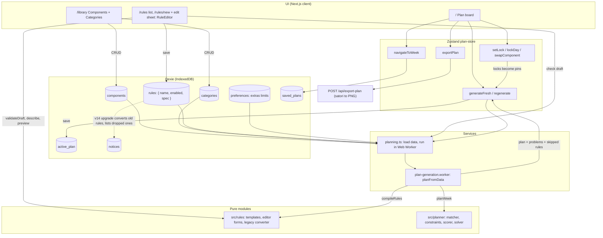
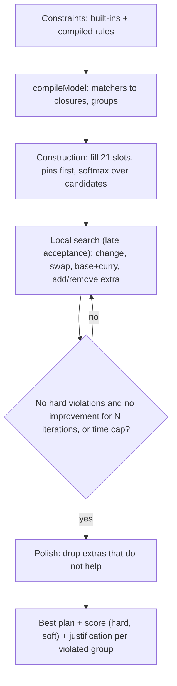

# Architecture

The weekly plan is produced by a constraint planner: rules **score** a whole candidate plan, and a
search looks for the plan with the best score. Rules are data (templates), not code paths in the
generator.

## App flow

## Rules model (`src/rules`)

A stored rule is `{ name, enabled, spec: { template, params } }`. Each template (never include, only
allow, always include, how often, no repeats, only at certain meals, leave out when, also include
when, prefer/avoid) has a params schema, a compiler to planner constraints, a description, the ids
it references, and form metadata the editor is generated from. Count-based templates take a
`must` (hard) or `prefer` (soft) strength.

Rules that are invalid or refer to deleted components or categories are skipped and named, never
applied with a changed meaning.

## Planner (`src/planner`)

- **Count** constraint: select assignments (component + role + day + meal), group them (slot, day,
  meal, week, per component, sliding k-day window), optionally only where a trigger exists in the
  same group, and bound the count with hard and/or soft min/max.
- **Prefer** constraint: soft cost or reward per matching assignment.
- **Score** is lexicographic: any hard violation outweighs every soft cost.
- **Built-ins** use the same primitives: plan structure, extras per meal, occasion days,
  curry–base compatibility, and preferences for a curry and subzi in every meal and for variety
  (repeats in the week cost a little, the same dish on the same or next day costs more).
- Locked parts of the plan are **pins** the search never moves; rules they break are reported.
