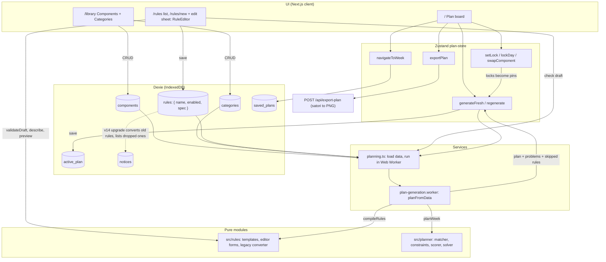
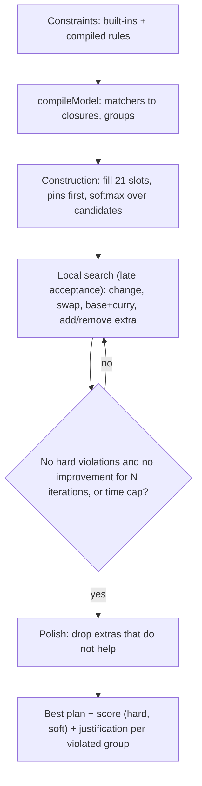

# Architecture

The weekly plan is produced by a constraint planner: rules **score** a whole candidate plan, and a
search looks for the plan with the best score. Rules are data (templates), not code paths in the
generator.

## App flow

## Rules model (`src/rules`)

A stored rule is `{ name, enabled, spec: { template, params } }`. Each template (never include, only
allow, always include, how often, no repeats, only at certain meals, leave out when, also include
when, only with these bases, never together, only on certain days, prefer/avoid) has a params schema, a compiler to planner constraints, a description, the ids
it references, and form metadata the editor is generated from. Count-based templates take a
`must` (hard) or `prefer` (soft) strength, and a `prefer` rule may set its own `cost` (1–10).

Every library starts with **default rules** (`src/rules/defaults.ts`): extras per meal, a curry and a
subzi in every meal, variety across the week, no dish on the same or next day, extras only when a
rule asks, and frequent over rare dishes. They are ordinary rules that can be edited or switched off;
their costs (5, 2, 3, 1) sit below a user's own `prefer` rules (10 by default).

Rules that are invalid or refer to deleted components or categories are skipped and named, never
applied with a changed meaning.

A rule may be owned by a component (`owner_component_id`, at most one per template), edited on that
component's form and listed under "Dish pairings" on the Rules page. A curry's or subzi's compatible
base categories are an `only with these bases` (`pairs_with`) rule; an extra's "never with these
curry types" is a `never together` (`avoid_with`) rule over `curry_category`; a dish's specific days
are an `only on certain days` (`allowed_days`) rule (any day, weekdays, weekends or specific days);
"never plan automatically" is an `exclude` rule. Occasion tags are only descriptive (`fasting`,
`festive`). Owned rules are renamed and deleted with their component and lose a deleted base category
instead of being skipped; a pairing left with no category is removed. With nothing chosen, a dish
goes with any base, any curry and any day (it owns no rule). The meal picker marks a choice as an override
when scoring the current plan with it adds a hard violation, so every rule counts there, not only
pairings.

## Planner (`src/planner`)

- **Count** constraint: select assignments (component + role + day + meal), group them (slot, day,
  meal, week, per component, sliding k-day window), optionally only where a trigger exists in the
  same group, and bound the count with hard and/or soft min/max.
- **Prefer** constraint: soft cost or reward per matching assignment.
- **Score** is lexicographic: any hard violation outweighs every soft cost.
- **Built-ins** are only the structure of a meal: one base, at most one curry and one subzi, each
  component in its own role, no extra twice. Everything else is a stored rule.
- Locked parts of the plan are **pins** the search never moves; rules they break are reported.
