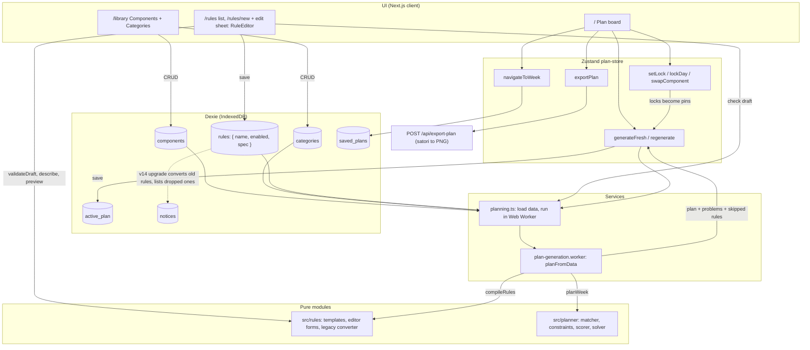
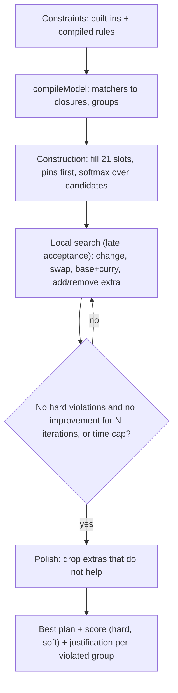

# Architecture

The weekly plan is produced by a constraint planner: rules **score** a whole candidate plan, and a
search looks for the plan with the best score. Rules are data (templates), not code paths in the
generator.

## App flow

## Rules model (`src/rules`)

A stored rule is `{ name, enabled, spec: { template, params } }`. Each template (never include, only
allow, always include, how often, no repeats, only at certain meals, leave out when, also include
when, only with these bases, never together, only on certain days, prefer/avoid) has a params schema, a compiler to planner constraints, a description, the ids
it references, and form metadata the editor is generated from. Count-based templates take a
`must` (hard) or `prefer` (soft) strength, and a `prefer` rule may set its own `cost` (1–10).

Every library starts with **default rules** (`src/rules/defaults.ts`): extras per meal, a curry and a
subzi in every meal, variety across the week, no dish on the same or next day, extras only when a
rule asks, and frequent over rare dishes. They are ordinary rules that can be edited or switched off;
their costs (5, 2, 3, 1) sit below a user's own `prefer` rules (10 by default). Each carries a stable
`default_key`, so it stays recognisable after a rename and "Restore defaults" can add back any that
were deleted without touching the ones that remain. Soft strength is shown in words (Slightly,
Moderately, Strongly); the stored numbers are unchanged.

Rules that are invalid or refer to deleted components or categories are skipped and named, never
applied with a changed meaning.

A rule may be owned by a component (`owner_component_id`, at most one per template), edited on that
component's form and listed under "Dish settings" on the Rules page. A curry's or subzi's compatible
base categories are an `only with these bases` (`pairs_with`) rule; an extra's "never with these
curry types" is a `never together` (`avoid_with`) rule over `curry_category`; a dish's specific days
are an `only on certain days` (`allowed_days`) rule (any day, weekdays, weekends or specific days);
"never plan automatically" is an `exclude` rule. Occasion tags are only descriptive (`fasting`,
`festive`). Owned rules are renamed and deleted with their component and lose a deleted base category
instead of being skipped; a pairing left with no category is removed. With nothing chosen, a dish
goes with any base, any curry and any day (it owns no rule). The meal picker marks a choice as an override
when scoring the current plan with it adds a hard violation, so every rule counts there, not only
pairings.

The Rules page groups rules as "Your rules", "Planner defaults" and "Dish settings" (the last two
collapsed), with a search box. A plan problem carries a plain `reason` (the rule's description, or a
built-in's label) and a `message` that adds where; links of the form `/rules#rule-<id>` and
`/library#dish-<id>` open and scroll to a rule or dish. A rule being edited is checked against the
library automatically once editing pauses.

## Planner (`src/planner`)

- **Count** constraint: select assignments (component + role + day + meal), group them (slot, day,
  meal, week, per component, sliding k-day window), optionally only where a trigger exists in the
  same group, and bound the count with hard and/or soft min/max.
- **Prefer** constraint: soft cost or reward per matching assignment.
- **Score** is lexicographic: any hard violation outweighs every soft cost.
- **Built-ins** are only the structure of a meal: one base, at most one curry and one subzi, each
  component in its own role, no extra twice. Everything else is a stored rule.
- Locked parts of the plan are **pins** the search never moves; rules they break are reported.

## Rules assistant (`src/assistant`)

An optional chat panel on the Rules page ("Ask assistant"). It answers questions about rules and the
current plan, and drafts rules and dishes from plain words. It runs entirely in the browser and calls
Gemini directly with the user's own key; there is no server route.

- `limits.ts`: caps (input length, tool calls, output tokens, history turns, list size) and a client-side rate limiter.
- `key-store.ts`: the Gemini key in `localStorage`, tolerant of blocked storage.
- `gemini.ts`: streaming `fetch` client (no SDK), the key sent in a header, and the `GEMINI_MODEL` constant.
- `retrieve.ts`: step 1, a local no-LLM slice of the library and rules relevant to the message.
- `prompt.ts`: constant system prompt, the `<data>` wrapper for untrusted text, and a cheap off-topic shortcut.
- `tools.ts` / `types.ts`: the closed tool set (declarations plus a never-throwing, Zod-validated dispatcher) and shared shapes.
- `compare.ts`: before-and-after sample week via the planning service.
- `agent.ts`: the loop that ties these together and emits text, draft and comparison events.
- `src/components/assistant`: `AssistantPanel`, `KeyPrompt`, `ComparisonView`, `DraftSheets`. Supporting
  pieces: `src/services/pins.ts` (locks to pins), `explainPlan` in `plan-generation.ts`, and a `draft` prop on `ComponentForm`.

**Data flow.** Step 1 builds a small slice locally (matched dishes, the rules that reference them,
a compact library summary, the discussed plan and its problems). Step 2 sends the slice and question to
Gemini, which may call read-only tools (`search_dishes`, `get_rule`, `list_rules`, `get_plan` for the
week's dish names, `explain_plan_slot` for one slot's dishes and problems, optionally checking which rules a
named dish would break there, and `simulate_with_rule` for the comparison below) and two draft tools
(`propose_rule`, `propose_dish`) that only validate and return a draft. A rule spec travels as JSON text.
If the plan store has not loaded yet (the Rules page opened directly), the panel loads the stored plan first. A rule draft opens in
the existing `RuleEditor` sheet, a dish draft in the existing `ComponentForm`; nothing is saved except
through their own Save button.

**Comparison.** For a rule draft the app plans the current week twice with the same seed and the same
pins (locked slots), once with the current rules and once with the draft added, locally in the planning
worker. The diff is computed in code; Gemini only words the summary. Adding a rule can reshuffle
unrelated slots, so changes outside the rule's matcher are described as reshuffled.

**Guardrails.** A fixed system prompt that refuses anything off rules, dishes and plans; only the
declared tools exist, and unknown tool names are rejected; arguments are validated and ids must exist;
no tool writes to the database; names from user data reach the model inside delimited data blocks that
it is told never to obey; message length, tool calls, output tokens, history and request rate are
capped; chat text is rendered as plain text. The limit is honest: this is client-side code with the
user's own key, so it stops drift, accidental misuse and prompt injection, not someone editing the page.

**Key storage.** The key sits in `localStorage` in plain text, and the panel says so, along with the fact
that relevant library data (names, ids, short descriptions, capped) goes to Google with each question.

**Known limits.** History is text-only (tool calls and results are not replayed on later turns), and
is kept in memory for the open panel. `GEMINI_MODEL` in `gemini.ts` has not been checked against
Google's live model list; a 404 shows "The Gemini model isn't available to this key.", and then it needs
updating. Replies are capped at 2048 output tokens; a turn that ends with no text and no draft shows a
short notice instead of an empty reply.
