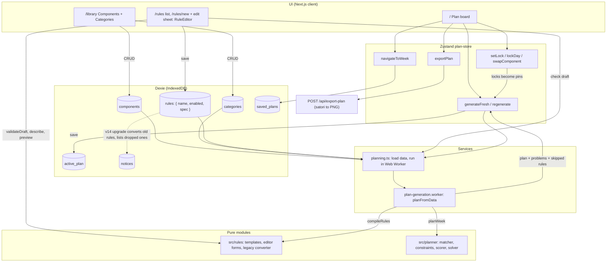
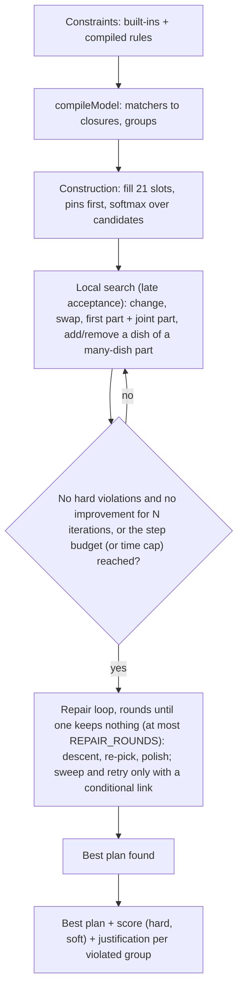

# Architecture

The weekly plan is produced by a constraint planner: rules **score** a whole candidate plan, and a
search looks for the plan with the best score. Rules are data (templates), not code paths in the
generator.

## App flow

## Rules model (`src/rules`)

A stored rule is `{ name, enabled, spec: { template, params } }`. Each template (never include, only
allow, always include, how often, no repeats, only at certain meals, leave out when, also include
when, only with these bases, never together, only on certain days, prefer/avoid) has a params schema, a compiler to planner constraints, a description, the ids
it references, and form metadata the editor is generated from. Count-based templates take a
`must` (hard) or `prefer` (soft) strength, and a `prefer` rule may set its own `cost` (1–10).

Every library starts with **default rules** (`src/rules/defaults.ts`): extras per meal, variety across
the week, no dish on the same or next day, curries, subzis and extras only when a rule asks, and
frequent over rare dishes. A meal is therefore its base alone until a rule (for example "also include
when" or "always include") asks for a side. They are ordinary rules that can be edited or switched off;
their costs (2, 3, 2, 1) sit below a user's own `prefer` rules (10 by default). Those two are no longer defaults (v19 removes them from libraries
where they were still off and unedited, and otherwise drops their `default_key`). Each remaining default carries a stable
`default_key`, so it stays recognisable after a rename and "Restore defaults" can add back any that
were deleted without touching the ones that remain. The seed runs once (`runSeed` has an in-flight guard and one
transaction), so React running effects twice cannot duplicate rules. Prefer and avoid weights are shown as Slightly,
Moderately or Strongly (`LEVELS`, weight only); the stored numbers are unchanged.

The v20 upgrade merges a library that was seeded twice: categories with the same kind and name, and dishes with the same type
and name, are merged into the copy with the lowest id (`src/db/dedupe.ts`). Dishes, rules and plans that named a removed copy
name the kept one; a removed dish's own rules are dropped where the kept dish has one for the same slot and moved to it otherwise.

The v19 upgrade also removes duplicate unowned rules (same name, spec and enabled flag; the lowest id stays) and converts
exact-shape hand-written `require_with` pairings (unowned, no extra categories, `when` a single base `id` or `base_category_id`
leaf, components all existing curries, subzis or extras) into dish-owned served-with links, keeping strength, scope and enabled.
It merges into a dish's existing served-with link only when enabled, strength and scope match; otherwise the hand-written rule
stays, trimmed.

### Meal parts (Stage 1)

Design: `docs/superpowers/specs`. Meal parts (user-defined: Base, Curry, Subzi, Extras today) are being built in stages. Stage 1 only
stores them next to today's fields; nothing reads them yet, so nothing visible changed. The old fields (`componentType`,
`base_category_id`, `curry_category`, `extra_category_id`, the tag arrays) stay the source of truth until Stage 4 and are removed in Stage 5.

- **Tables (v21).** `parts` (`src/types/part.ts`: name, position, `varied`) and `tag_groups` (`src/types/tags.ts`). A dish gains `part_id`,
  `category_id` and `tags` (group id to value ids). `CategoryKind` gains `'curry'`: one category of the Curry part per curry type in use,
  named by the stored type value and hidden from the category UI.
- **Conversion.** `src/db/parts.ts` is a pure converter (`convertLibrary`, `convertDish`; `CONVERTED_PARTS`, `CONVERTED_TAG_GROUPS` fix the
  names and order: Base, Curry, Subzi, Extras; Dietary, Protein, Region, Occasion). The v21 upgrade runs it over stored rows, keeping every dish, rule and plan.
- **New databases.** Dexie does not run upgrades on a new database, so the seed calls `ensurePartsAndTagGroups()` (`src/db/parts-store.ts`),
  which matches stored parts and groups by converted name and creates any that is missing.
- **Staying in step.** `src/services/parts-db.ts` derives the new fields from the old ones when a dish is added, updated or saved (an update
  rewrites them only when a source field changed); `addCategory` sets `part_id`; `deleteCategory` clears `category_id` with the old reference.
- **For Stage 4.** The seed and every dish save (not only the seed) match parts, tag groups, tag values and curry categories by name
  (`loadConvertLookup` in `src/db/parts-store.ts`). Renaming a part would make the next save create a second one. A save also rewrites a
  dish's whole `tags` map, but only when a source field changed. Both must be revisited when the new fields become the source of truth.

### Meal parts (Stage 2)

Design: `docs/superpowers/specs`. The planner now works over parts. Storage, locks, pins and lock keys keep today's shape until Stage 5, so nothing
visible changed except the two cap rules on the Rules page, and a converted library plans the same weeks as before (`repair.snapshot.test.ts`).

- **Input.** `ModelInput.parts` (`PlannerPart`: id, name, `varied`) lists the meal's parts in order; the first holds exactly one dish. A solver slot
  is one dish list per part (`SlotState.parts`), `PartSlot` and `PartPins` are the same by part id. Each dish carries its derived `part_id`, and an
  assignment names the part it is placed in (`part`); the dish's own part is `c.part_id`. `loadPlanningInput` fills a missing `part_id` from `componentType`.
- **Single and many.** A part is single (one dish) when the first part, or when a hard per-meal cap of 1 selects it (`cappedPart`, `capped` in
  `builtinConstraints`); otherwise it holds many. Only many parts get the "no dish twice" built-in, and the pick, swap and descent moves change
  single parts while add/remove moves change many parts.
- **Rules reach the planner as rules about parts.** Stage 2 rewrote every `role` and `componentType` leaf of a compiled constraint to a `part` leaf
  (`src/rules/legacy-parts.ts`, `constraintOverParts`). Stage 3a stores rules over parts, so that rewrite now only serves rules still holding the
  old leaves. The files that still name base, curry, subzi or extras are listed under Stage 3a.
- **Cap rules.** "At most one Curry per meal" and "At most one Subzi per meal" (`capRules` in `src/rules/defaults.ts`) replace the built-in one curry
  and one subzi. They are Always `limit` rules with no default key, added by the v22 upgrade (only when the library has dishes), the seed and the
  rule-case runner, and the user can edit, disable or delete them. Having no default key, "restore defaults" cannot bring a deleted cap back.
- **Boundary caps.** A stored plan holds one curry and one subzi, so `legacySlotCaps` (`src/services/legacy-slots.ts`) adds structural caps of 1 for the
  Curry and Subzi parts on every app path that plans (`planFromData` and the paths around it), whatever the user's rules say. Base needs none.
  A deleted cap rule therefore changes nothing yet; "delete the cap, get two curries" arrives in Stage 5 with its rule case. The planner itself
  supports many dishes per part (`parts.test.ts`: Main, Side, Dessert).
- **Guards.** `buildModel` throws `InvalidConstraintError` for any `role` leaf (a rule the rewrite missed would silently match nothing) and for
  `slot_part` in a constraint that is not a built-in; `slot_part` is planner-internal and names where a dish is placed.
- **Joint part and locks.** The joint part is the first single part after the first (the curry): the base+curry move changes it with the first part.
  `lockNudge` counts locked dishes of every other part after the first, leaving the joint part out (`pivotPart` in `solver.ts`). The repair
  sweep no longer skips it: a curry only a conditional link brought leaves where it breaks a hard rule (rule case `sweep-takes-out-a-brought-curry`).

### Meal parts (Stage 3a)

Design: `docs/superpowers/specs`, plan `docs/superpowers/plans/2026-11-22-meal-parts-rules-a.md`. Stored rules and links now name parts. Weeks do not
change except where an upward link flips (below); `repair.snapshot.test.ts` is untouched.

- **Part identity.** A part and a tag group carry `legacy` (the converted name it began as: Base, Curry, Subzi, Extras; Dietary, Protein, Region,
  Occasion), written by v23 and by the seed (`ensurePartsAndTagGroups`). Renaming a part keeps `legacy`. Code that needs "the curry part" (presets, caps,
  the conversion) finds it by `legacy` through `legacyPartIds`, never by name.
- **Rule shapes.** Leaves are `part` and `category` (a category id), not `role`, `componentType`, `base_category_id`, `extra_category_id` or
  `curry_category`. `only_allow`, `skip_when` and `no_repeat` take part ids (`no_repeat` without parts means every part; v24 writes them explicitly).
  Descriptions and the editor read part names from the stored parts. A rule naming a deleted category reads "category #n".
- **Every rule is planned as stored.** The Stage 2 stock-default substitution (`partsSpec`: a default equal to the stock spec followed `varied`) is
  gone. A default plans over the parts it lists. Stage 4 must rewrite never-edited stock defaults when parts are added, removed or `varied` is toggled.
- **Link shapes.** `LinkTarget` is `{ part, kind }` (kind: category or dish; `src/rules/owned.ts`). Any part may link to any part in the UI;
  the rule is always modelled top to bottom, a higher dish decides and a lower one follows:
  - **comes** (`comes:<target>`, `comes_with`): the owner brings a dish of a lower part.
  - **serve** (`serve:<target>`, `require_with`): the owner is added when a dish of a higher part is in the meal. Today's "served with bases" is the serve
    link to the first part. "Papad comes with Sambar" (Extras over Curry) is stored as "when Sambar is in a meal, Papad is added".
  - A comes link into the owner's own part (a sibling) exists only for a part that is not the first and is not capped at one per meal (today, extras).
    It is never wrong-way, and a comes link may name a `when` for any part except the part it brings into and the first part (the model allows this; the link editor offers a
    wait only to a first-part owner's link, on the capped parts after the first that sit above the target's part: extras wait on curry and subzi, subzi on
    curry, curry on nothing, and a stored wait stays editable).
  - `offersLink` and `addableSlots` take the parts and the capped parts (read from the cap rules), so a dish is offered only links that mean something.
- **v24.** Converts stored rules and links to these shapes in one transaction (`src/db/rules-over-parts.ts`, `convertRuleSpec`), keeping every rule. A stock
  default becomes `defaultRules(parts)`'s spec for its key; an edited one gets the plain leaf conversion. Existing upward links flip: a subzi or extra that
  "comes with" a curry becomes "added when that curry is in the meal". An upward comes link with a `when` stays comes (flipping would lose its condition;
  today's UI cannot make one) and the wrong-way check names it. Flipped links keep their old rule names until renamed.
- **Frozen builders.** v14 to v22 keep writing the shapes of their own time: `src/db/legacy-rules.ts` (v15 to v22 builders, a copy of the id remapping v20 used)
  and `src/db/legacy-v14.ts` (the v14 converter and its dependencies). Only `src/db/client.ts` and db tests may import them (an isolation test enforces it).
  Each upgrade test now ends at v24, and asserts v24 output.
- **Wrong-way links.** After a reorder (Stage 4) a comes link whose target is not below its owner, or a serve link whose target is not above it, is skipped by
  `compileRules` and named as a rule issue; the link list shows the same notice. Nothing is deleted.
- **Solver.** A dish placed in any part brings its pairings: a base brings Sambar, Sambar's serve link brings Papad (chained, up to `BRING_ROUNDS`). Adding or
  removing a dish in a many-dish part brings or takes its pairings in other parts. A link within one part keeps the old add-and-remove-alone path, and a dish
  that brings nothing across parts takes the old path.
- **Rule-case runner.** A case may carry its own parts (`PlanCase.library`, `CaseWeeks.parts`), so cases run on any parts (Main, Side, Dessert); the default rules
  are built over the parts the library has, but a custom library gets no default cap rules (they exist only for the converted Curry and Subzi), so a case that
  needs a cap writes it as a rule. A case may declare `issues` it expects (rule issues such as a wrong-way link); unexpected issues still fail it. Helpers that read the
  legacy weeks throw on a custom library.
- **Files that still name base, curry, subzi or extras** (the legacy list): `src/db/parts.ts`, `src/db/seed.tsx`, `src/db/seed-data.ts`,
  `src/db/legacy-rules.ts`, `src/db/legacy-v14.ts`, `src/db/rules-over-parts.ts`, `src/rules/legacy-parts.ts`, `src/rules/defaults.ts`, `src/rule-cases/run.ts`,
  `src/components/rules/presets.ts` (finds Subzi and Curry by `legacy`), `src/services/legacy-slots.ts`, `src/services/pins.ts`, `src/services/plan-generation.ts` (until Stage 5), the upgrades,
  `src/rules/legacy-parts.ts` also holds `appSingleParts` and `convertedPartIds` (until Stage 5). `src/assistant` is no longer a legacy file: it works over parts, and only its
  dish drafts keep the old fields (until Stage 4).
- **Stage 3b** closed the list that Stage 3a left open (next section). Removal does not cascade to an orphaned side until polish, as before.

### Meal parts (Stage 3b)

Design: `docs/superpowers/specs`, plan `docs/superpowers/plans/2026-11-24-meal-parts-rules-b.md`. Link warnings, the rule form, the assistant and the
picker now read parts. Unlike Stage 3a, two planner fixes move weeks, only where the conflicts below occur (decided 2026-11-25).

- **Warnings over capped parts.** `link-warnings.ts` reasons about `singleParts(parts, rules)`: the parts a cap rule holds to one dish per meal, plus the
  legacy single parts (the converted Curry and Subzi, `appSingleParts` in `src/rules/legacy-parts.ts`) until Stage 5. The assistant uses the same
  function. Messages use part names. A side that links to the first part is a serve link (it used to be an error). A dish without `part_id` gets no link warnings.
- **Rule form categories.** The category field of a rule offers categories by kind: `pairs_with` takes the first part's categories; `require_with`
  takes the uncapped parts after the first (converted libraries: Extras only), labelled with the part only when more than one part offers categories.
  A stored category outside that set still round-trips.
- **Assistant over parts.**
  - The slice (`summary.parts`) lists each part with its id and categories. `propose_rule` matches `part`, `category` and the other `CONDITION_FIELDS`
    (the four tag arrays, not `tags`). A draft using an old field (`componentType`, `role`, `base_category_id`, `extra_category_id`, `curry_category`)
    is refused.
  - `propose_dish` and `propose_pairing` take one `links` argument, by part. A part above the dish means served with it (the dish is added when one of
    them is in the meal); a part below means the dish brings it (`bringMode`); a dish's own part only where `offersLink` allows. The draft reports the
    dishes it linked.
  - Link targets match by exact name or id only, never by a single fuzzy search hit ("Rice" does not become "Lemon Rice").
  - Dish drafts (`componentType`, `base_category`, `extra_category`, `curry_category`, the tag arrays) stay on the old fields until Stage 4.
- **Picker.** A dish picked by hand re-plans its meal (`replanMeal` in `plan-store.ts`). A base pick frees the meal's other parts, as before. Any other
  pick runs two passes: the first plans the meal with the pick pinned and the other parts free, to find what the pick brings; `settleMeal`
  (`src/services/pins.ts`) keeps the meal as picked plus only the sides the pick brings, chaining through `PairedSide.by` (not sides the base brought);
  the second pass pins that meal, so every rule is checked on it.
- **Planner fixes** (rule cases pin the fixed behaviour):
  - The repair sweep's curry exemption is gone: a curry that only a waiting link brought can be swept when it breaks a hard rule
    (`sweep-takes-out-a-brought-curry`).
  - A higher part's Always link wins a one-dish part over the sides of lower parts. The solver (`fits`) lets it take the part from a dish held only by
    lower sides; the scorer charges the missing Always pairing as a hard problem, no longer suppressed, including against a pinned or hand-picked lower dish
    (`two-links-bring-a-subzi` and the locked-subzi case).
  - `pivotPart` keeps the joint move and `lockNudge`. `repair.snapshot.test.ts` is untouched.
- **What stays.** No removal cascade (removing a dish leaves a side it brought). An extras pick pins the extras list to that dish, as a swap does today.
- **Closed from the Stage 3a list:** link warnings over cap rules, the assistant, condition fields and presets over parts, the joint part, a flipped
  subzi to curry link bringing its subzi, and the picker bringing for a hand-picked dish.

Rules that are invalid or refer to deleted components or categories are skipped and named, never
applied with a changed meaning.

A rule may be owned by a component (`owner_component_id`, at most one per template), edited on that
component's form (`comes_with` is owned-only: `OWNED_ONLY_TEMPLATES`, hidden from the Rules page and the assistant's rule templates, and its `of` must pin one kind of dish); the Rules page does not list owned rules, and a link to one goes to its dish. Any dish can own a list of **goes with / never with**
links (`DishLink` in `src/rules/owned.ts`). A link has a mode, a target, values, a strength and an optional scope. The target is
a part and a kind (`LinkTarget`): the categories of another part (base categories, extra categories, curry types today) or specific dishes (bases, curries,
subzis, extras); a dish is never offered its own kind where a meal holds only one, and a dish is offered its own part only where a meal may hold two. "Only with" limits the dish to the chosen values, "never with" keeps it away from them; none chosen is no rule. Both modes
of one target may be set at once, each as its own rule (`with:<target>`, `never:<target>`). A dish may also **come with** sides
(`comes:<target>`, a `comes_with` rule): a base, curry, subzi or extra brings one of the chosen side dishes (or a side of the chosen
categories) into its meal, so Idiyappam can come with Kerala Stew. A dish may hold several comes links of one kind, each its own
rule. An old "only with" link to side targets still compiles as the limit it was and is listed with a note; editing it stores it as
comes. A curry, subzi or extra may also be
**served with** specific dishes or categories of a higher part (`serve:<target>`, a `require_with` rule the dish owns): whenever one of them
is in the meal, the dish is added. Served with the first part is how a side is added to a base (see Stage 3a for the part-based shapes). The planner plans a base together with
its served-with dishes (see **Pairings as units** below); picking a base by hand on the plan re-plans only that meal through the
planner: `pinsForMeal` in `src/services/pins.ts` pins every other meal exactly (and holds a part empty with `null` in
`SlotPins`), so the meal's sides follow every rule and locked parts stay. The re-plan is applied only if the meal is still as
picked, and a replaced base takes the sides it brought with it.

Strength is one set of words, `STRENGTH_WORDS` in `src/rules/levels.ts`: **Always** (`must`), **Usually**, **Often** and
**Sometimes** (`prefer` with cost 10, 6 or 3). Links, the Rules page cost select and the assistant all use it. A stored cost
reads back as Usually at 8 or more, Often at 5 to 7 and Sometimes at 4 or less, so older links keep their meaning. A scope limits a link to some days or meals. Storage is unchanged: "only with base categories" is a
`pairs_with` rule (which also accepts `scope`, editable on the Rules page), every other link ("never with", or "only with" a dish or a non-base category) an `avoid_with` rule whose other
side is the dish type plus the (negated) categories; a comes link is a `comes_with` rule and a served-with link a `require_with` rule.

On the dish form, "Goes with" is a list of sentences (`describeLink`, with `shortLink` for the row badges in
`src/rules/link-text.ts`), each with Edit and Remove, and an "Add link" flow (`src/components/library/links`) with a searchable
option picker and optional day and meal limits. `addableSlots(ownerPart, links, targets, parts, capped)` in `src/rules/owned.ts` lists the slots Add may still fill: every mode `linkModes` offers from the owner's part to each target (`linkTargets` lists them), except a slot the dish already fills. A bring slot below the first part ("comes with", or "served with" a higher part) may be repeated, so a dish may hold several. `LinkEditor` offers, per target, the modes `linkModes` returns: to the first part the bring mode ("Served with" or "Comes with"), "Only with" and "Never with"; to any other part the bring mode and "Never with"; to the owner's own part "Comes with" and "Never with", only where `offersLink` allows (not the first part, not a part capped at one per meal). Existing links always stay listed and editable. A stored link that is switched off (as the v19 upgrade may leave a hand-written pairing) is
marked "(off)" and stays off until it is changed and saved, which switches it on; `propose_pairing` treats it as not in force. Links are tracked by rule id (`DishLink.ruleId`; `readOwned` keeps every link, `linkChanges` diffs the form's links against the stored ones, and `saveComponent(..., links)` and `pendingRules(..., links)` take them), so links left untouched are never rewritten on save. `link-warnings.ts` shows
warnings: a contradiction between modes, nothing plannable to pair with, and a link hidden by another dish's meal or
day limits. Warnings block Save when a meal could not hold both, since it holds one curry and one subzi: a second curry (or subzi)
**Always** served with the same base, two **Always** comes links of one kind that name no dish in common, and an Always served-with
link against an Always comes link that leaves no room for it (checked from either dish's form), and a meal-level clash: a dish
always brings a curry (or subzi) whose own Always comes link to the other role shares no dish with the dish's own Always link
to that role (blocked only when every dish the link may bring clashes; also checked from the curry's form, against a dish
that always brings only that curry). A base's clashes are judged by the category chosen in the form. A narrowing warning (a dish always
served with the base makes the other chosen dishes unreachable) does not block. The comes-related clash checks skip scoped links.
Only a conflict the edit introduces blocks; one already stored does not. `propose_dish` and `propose_pairing` refuse the same thing (`propose_pairing` judges the draft together with the dish's links in force, and refuses only a clash on a drafted link). The form also lists, read only, "Other rules mentioning this dish" (linking to `/rules#rule-<id>`), and in edit mode
a "Preview on this week" button that compares the current plan with and without the unsaved links
(`compareRuleSets` and `pendingRules` in `src/services/compare-rules.ts`; it needs a stored plan). Rows and forms share one
library lookup (`LibraryLookup.tsx`: dishes, categories and all rules, provided by `ComponentTab`; outside it, the hook runs its
own queries).

Served with is edited on the lower dish; comes with on the dish that brings the lower one (a base included); Manage Categories has
no pairing editor. A dish's specific days
are an `only on certain days` (`allowed_days`) rule (any day, weekdays, weekends or specific days);
"never plan automatically" is an `exclude` rule. Occasion tags are only descriptive (`fasting`,
`festive`). Owned rules are renamed and deleted with their component and lose a deleted value
instead of being skipped, keeping the link's scope and strength; a link left with no value is removed. With nothing chosen, a dish
goes with any base, any curry and any day (it owns no rule). The meal picker marks a choice as an override
when scoring the current plan with it adds a hard violation, so every rule counts there, not only
pairings.

The Rules page groups rules as "Your rules" and "Planner defaults" (the last collapsed), with a
search box; dish settings (owned rules) are not listed there. A plan problem carries a plain `reason` (the rule's description, or a
built-in's label) and a `message` that adds where; links of the form `/rules#rule-<id>` and
`/library#dish-<id>` scroll to a rule or dish, highlight it and open its editor; a link to a dish
setting goes to the dish that owns it. A rule being edited is checked against the
library automatically once editing pauses.

## Planner (`src/planner`)

Every step that places a dish brings its pairings with it (see below), so a base is always scored with its sides in place.

- **Count** constraint: select assignments (component + part + day + meal), group them (slot, day,
  meal, week, per component, sliding k-day window), optionally only where a trigger exists in the
  same group, and bound the count with hard and/or soft min/max.
- **Prefer** constraint: soft cost or reward per matching assignment.
- **Score** is lexicographic: any hard violation outweighs every soft cost.
- **Built-ins** are only the structure of a meal: the first part holds one dish, each dish sits in its own part, no dish twice in a part that holds many.
  Everything else is a stored rule, including "At most one Curry per meal" and "At most one Subzi per meal"
  (`capRules`, added by v22 and the seed). A part with a hard per-meal cap of 1 holds one dish (`capped`).
- **Pair** constraint: when a meal holds a dish matching `when`, it should also hold a dish matching `of` (a set of candidates);
  missing it is a hard violation (`must`) or costs `cost` (`prefer`).
- Locked parts of the plan are **pins** the search never moves; rules they break are reported.
- The **repair loop** runs after the random search: a round runs the move kinds in a fixed order, each over the whole week
  (descent: every single change of a free base, curry or subzi, kept if it strictly improves; re-pick of a link's dish;
  sweep of conditional sides that break a hard rule; polish: drop a side whose removal improves; retry of a refused
  conditional side). Polish keeps its own part-major order over the week: part by part, in order (on a converted library: curry, subzi, then
  extras, the extras last dish to first). Sweep and retry run only when a link waits for a curry or subzi (a
  conditional link); without one the kinds are descent, re-pick and polish. Rounds repeat until one keeps nothing, for at most `REPAIR_ROUNDS` (10). Re-pick and retry keep
  not-worse changes, so each remembers across rounds what it already tried. The safety cap does not cut it short.
- **Search budget** (`src/planner/budget.ts`): the random search runs `searchBudget` iterations, where
  `clamp(36000 + 150 * dishes + 400 * pairs, 36000, 200000)`, and stops earlier on a plateau (3000 iterations with no
  improvement and no hard violation). Steps, not time, decide the result, so a plan for a given seed does not depend on machine
  speed, unless the safety cap fires. Derivation: `docs/superpowers/plans/2026-11-16-planner-search-budget-measurements.md`.
- **Safety cap**: `timeLimitMs` is only a cap (`SAFETY_CAP_MS`, 10 s). When it cuts the search short, Generate or Regenerate
  shows "Planning took too long on this device, so this is the best week found in 10 seconds. Regenerate to try again." in
  `PlanProblemsBanner`. The note is not stored, and the meal picker and previews ignore it.
  The cap stops only the random search; the repair loop after it is bounded by its round count, so a capped Generate can run a little past 10 s.

### Pairings as units

Design: `docs/superpowers/specs/2026-11-08-pairing-units-design.md`. A base and its **Always** pairings are one unit: choosing
Pongal means choosing Pongal with the Sambar always served with it. Softer pairings (Usually, Often, Sometimes) bring their
side along when it fits and give way otherwise. Either way, a pairing never makes its base less likely to be planned.

- **Compiling.** An enabled `require_with` that names specific dishes, and a `comes_with` rule (one pair whose `of` is all
  the dishes it names), compile to `pair` constraints (`must` makes units, `prefer` makes asked-for sides); `require_with`'s
  `extraCategories` stay ordinary counts. Any one candidate meets a pair, and a pair with no candidate in the library is ignored. A pairing's scope limits where it applies.
  **Levels.** `compileRules` gives every count and prefer constraint a `level` (`src/planner/constraints.ts`; pairs have none),
  set by the template from the rule's params and origin and by `levelOf` in `src/rules/record.ts`. It is derived at compile
  time, never stored. The Rules page shows it as a badge (`ruleLevel`), and the scorer reads "gives way to" from the level alone:

  | Level | Rules | Gives way to |
  |---|---|---|
  | `rule` ("Your rule") | hand-written rules that are not frequency rules (never include, only allow, always include, meals or days, leave out when, never together, "how often" per meal), and the minimum half of a split count | nothing |
  | pairs ("Brings a dish") | comes with, served with, "also include when" | nothing; they bring dishes |
  | `dish` ("Dish limit") | a dish's own owned rules (days, meals, only/never with), the extras-per-meal default caps, retired defaults still stored | Always pairs (units) |
  | `frequency` ("Frequency") | "how often" per day or week with a maximum, no repeats, prefer and avoid, hand-written or owned; the variety, spacing and sides-only-when-asked defaults | any pair (units and asked-for sides) |

  A brought dish sits below the dish that brought it, so frequency rules never make that dish rarer. A frequency count with a
  minimum too is split in two (`rule:<id>:<i>` keeps the minimum on the `rule` level, `rule:<id>:<i>:max` is `frequency`).
  A hand-written rule that is not a frequency rule still beats a link: "never include Papad" stops Rice's link.
- **Scoring.** Each score works out every meal's unit members and asked-for sides from the `pair` constraints whose trigger is
  present. A unit member is not counted by `dish` and `frequency` constraints (its own days, meals, links, never-auto, the defaults);
  an asked-for side is not counted by `frequency` ones, so every frequency rule yields to asked-for sides too. A unit member does not trigger rules owned by its meal's base.
  `rule`-level constraints and built-ins never give way. Where one capped part (curry or subzi) is wanted by several pairs of a base, the first
  (Always before softer, then lowest rule id) is charged; a later one that shares a candidate with it is charged too (one dish can meet both), and a disjoint one is suppressed
  (reported as a conflict, not charged). Between dishes of different parts a higher part decides: a missing Always pairing gives way to a
  unit member holding its part only when a dish of the same or a higher part brought it, and `bring` lets an Always pairing take a one-dish
  part from a unit member only lower parts bring (Idli's Avial over the Beans Poriyal served with Sambar; rule case `two-links-bring-a-subzi`).
  Nothing is stored: plans, `explainPlan`, `slotConflicts` and draft checks
  all see the same result as the solver.
- **Solving.** Placing a dish (construction and every move) brings its pairings in the same step, into free parts only and
  never over a pin, then their own pairings (up to `BRING_ROUNDS`). This holds in every part: a dish served with a curry follows that curry whether a base brought it or the search placed it, and adding or removing a dish of a many-dish part (a curry, where curries have no cap) brings or takes its pairings when one of them is in another part (a link within the part, such as an extra that comes with another extra, leaves the dish added and removed alone). Among a pairing's several dishes `chooseCandidate` ranks each candidate, scored with its own sides brought, by hard score, then
  the candidate's own `dish` limits it overrides (`ownRulesOverridden`: its days, meals and never-auto, which give way to a unit member),
  then the `frequency` limits it breaks as a freed pick, then soft score. `broughtScore` returns these as separate components
  (`BroughtScore { hard, overrides, limits, soft }`), compared in that order by `compareBrought`, not folded into one weighted sum; ties go to the lowest weighted use `(times planned + o) × 2^w`, where `w` is the weight of the prefer rules that
  give way to a brought dish (`yieldedPreferWeight`; by default frequent −1, rare +1, and "sides only when a rule asks" +2 on every
  side) less the lowest such weight among the candidates, so a weight they all share changes nothing (at most 4), and `o` a per-candidate offset in [0, 1) drawn from a separate
  stream seeded by the solve's seed (0.5 in the meal picker), then rotation (each meal starts from a different candidate, which in
  practice only matters in the meal picker). Unit members stay while their base does; asked-for sides
  are free, and polish may drop one.
- **Conflicts.** Where stored data holds two Always curries (or subzis) for one base, the rule with the lower id makes the unit
  and the other is reported once as a soft problem; it never blocks the base. A pinned or held-empty part keeps the pin, and
  the missing pairing is reported as "replaced by your pick".
- **Around the planner.** `PlanningOutcome.paired` (`pairedSides` in `src/services/plan-generation.ts`) lists each meal's
  paired sides with the candidates and the rule that brought them (`SlotPair`, `PairedSide`; `bringsWith` returns `{ wants }`), and the plan board labels such a side "with <base>", also on a reloaded plan. The meal picker
  (`slotConflicts`) places a candidate base with its unit before counting problems. `explain_plan_slot` reports paired sides, naming the bringing rule in `pairedWith.how` ("Idiyappam comes with Kerala Stew (Veg)",
  "Sambar is served with Pongal"), and never gives a missing pairing as the reason a base is left out; the prompt tells the assistant to give only reasons a tool returned.

## Rule case library (`src/rule-cases`)

Design: `docs/superpowers/specs/2026-11-08-rule-cases-design.md`. A catalogue of situations, each with its dishes, rules
(built the way the app stores them, with the default rules unless a case turns them off), optional pins, and plain-sentence
expectations checked over 8 planned weeks (seeds 1–8). Groups: Pairings, Days and meals, Variety, Locks and picks, Extras
(`src/rule-cases/cases`). It covers the rule engine and planner only, no UI.

- Cases use their own test library (`library.ts`), never the seed library or user data.
- Runs use a fixed iteration budget (`run.ts`: the same `searchBudget` as the app, with no time limit), so results do not depend on machine speed.
- A case's `rules`, `pins` and `without` (default rules by `default_key`) are what it is about; supporting rules go in
  `given`. `rule-cases.test.ts` plans every case without its subject (`failsWithoutSubject` in `run.ts`) and fails it if all
  its expectations still pass, since such a case proves nothing.
- Cases run with `npm test`; `npm run rule-cases` also writes the standalone `rule-cases-report.html` from the same run.
  The report is not part of the app (no route, no import from app UI).

## Rules assistant (`src/assistant`)

An optional chat panel on the Rules page ("Ask assistant"). It answers questions about rules and the
current plan, and drafts rules and dishes from plain words. It runs entirely in the browser and calls
Gemini directly with the user's own key; there is no server route.

- `limits.ts`: caps (input length, tool calls, output tokens, history turns, list size) and a client-side rate limiter.
- `key-store.ts`: the Gemini key in `localStorage`, tolerant of blocked storage.
- `gemini.ts`: streaming `fetch` client (no SDK), the key sent in a header, and the `GEMINI_MODEL` constant.
- `retrieve.ts`: step 1, a local no-LLM slice of the library and rules relevant to the message.
- `prompt.ts`: constant system prompt, the `<data>` wrapper for untrusted text, and a cheap off-topic shortcut.
- `tools.ts` / `types.ts`: the closed tool set (declarations plus a never-throwing, Zod-validated dispatcher) and shared shapes.
- `compare.ts`: the assistant's before-and-after sample week; a thin wrapper over `compareRuleSets` in `src/services/compare-rules.ts`, which the dish form's link preview also uses.
- `agent.ts`: the loop that ties these together and emits text, draft and comparison events.
- `src/components/assistant`: `AssistantPanel`, `KeyPrompt`, `ComparisonView`, `DraftSheets`. Supporting
  pieces: `src/services/pins.ts` (locks to pins), `explainPlan` in `plan-generation.ts`, and a `draft` prop on `ComponentForm`.

**Data flow.** Step 1 builds a small slice locally (matched dishes, the rules that reference them,
a compact library summary, the discussed plan and its problems). Step 2 sends the slice and question to
Gemini, which may call read-only tools (`search_dishes`, `get_rule`, `list_rules`, `get_plan` for the
week's dish names, `explain_rule` for whether a rule is active and where the plan breaks it, `explain_plan_slot` for one slot's dishes and problems, optionally checking which rules a
named dish would break there, and `simulate_with_rule` for the comparison below) and two draft tools
(`propose_rule`, `propose_dish`, `propose_pairing`; ten tools in all) that only validate and return a draft. A rule spec travels as JSON text; `propose_rule` and `simulate_with_rule` refuse an owned-only template (`comes_with`) and point the model at `links` on `propose_pairing` or `propose_dish`. `propose_dish` and `propose_pairing` take one `links` argument, by part (see Stage 3b): the links a new dish is saved with, or new links for a dish that
already exists. "Review pairing" opens that dish's form in edit mode with the draft merged over its stored links, and saving
writes only the new link. Rule and link drafts name parts and categories by id; dish drafts keep the old fields until Stage 4.
Each question makes at most 5 requests to Gemini (the last one without tools, so it must answer); the prompt
tells the model to answer from the slice when it can and to batch its tool calls into one step.
If the plan store has not loaded yet (the Rules page opened directly), the panel loads the stored plan first. A rule draft opens in
the existing `RuleEditor` sheet, a dish draft in the existing `ComponentForm` (a pairing draft in edit mode); nothing is saved except
through their own Save button.

**Comparison.** For a rule draft the app plans the current week twice with the same seed and the same
pins (locked slots), once with the current rules and once with the draft added, locally in the planning
worker. The diff is computed in code; Gemini only words the summary. Adding a rule can reshuffle
unrelated slots, so changes outside the rule's matcher are described as reshuffled.

**Guardrails.** A fixed system prompt that refuses anything off rules, dishes and plans; only the
declared tools exist, and unknown tool names are rejected; arguments are validated and ids must exist;
no tool writes to the database; names from user data reach the model inside delimited data blocks that
it is told never to obey; message length, tool calls, output tokens, history and request rate are
capped; chat text is rendered as plain text. The limit is honest: this is client-side code with the
user's own key, so it stops drift, accidental misuse and prompt injection, not someone editing the page.

**Key storage.** The key sits in `localStorage` in plain text, and the panel says so, along with the fact
that relevant library data (names, ids, short descriptions, capped) goes to Google with each question.

**Known limits.** History is text-only (tool calls and results are not replayed on later turns), and
is kept in memory for the open panel. `GEMINI_MODEL` in `gemini.ts` has not been checked against
Google's live model list; a 404 shows "The Gemini model isn't available to this key.", and then it needs
updating. Replies are capped at 2048 output tokens; a turn that ends with no text and no draft shows a
short notice instead of an empty reply.
