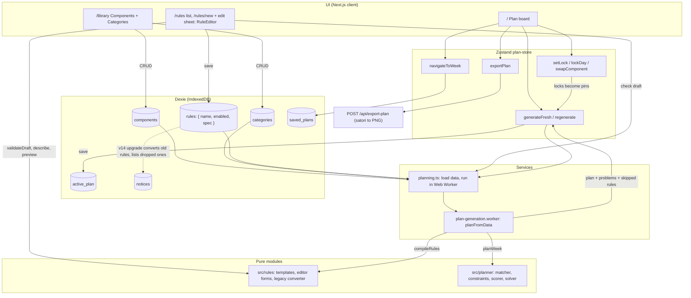
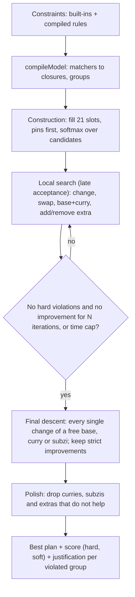

# Architecture

The weekly plan is produced by a constraint planner: rules **score** a whole candidate plan, and a
search looks for the plan with the best score. Rules are data (templates), not code paths in the
generator.

## App flow

## Rules model (`src/rules`)

A stored rule is `{ name, enabled, spec: { template, params } }`. Each template (never include, only
allow, always include, how often, no repeats, only at certain meals, leave out when, also include
when, only with these bases, never together, only on certain days, prefer/avoid) has a params schema, a compiler to planner constraints, a description, the ids
it references, and form metadata the editor is generated from. Count-based templates take a
`must` (hard) or `prefer` (soft) strength, and a `prefer` rule may set its own `cost` (1–10).

Every library starts with **default rules** (`src/rules/defaults.ts`): extras per meal, variety across
the week, no dish on the same or next day, curries, subzis and extras only when a rule asks, and
frequent over rare dishes. A meal is therefore its base alone until a rule (for example "also include
when" or "always include") asks for a side. They are ordinary rules that can be edited or switched off;
their costs (2, 3, 2, 1) sit below a user's own `prefer` rules (10 by default). Those two are no longer defaults (v19 removes them from libraries
where they were still off and unedited, and otherwise drops their `default_key`). Each remaining default carries a stable
`default_key`, so it stays recognisable after a rename and "Restore defaults" can add back any that
were deleted without touching the ones that remain. The seed runs once (`runSeed` has an in-flight guard and one
transaction), so React running effects twice cannot duplicate rules. Prefer and avoid weights are shown as Slightly,
Moderately or Strongly (`LEVELS`, weight only); the stored numbers are unchanged.

The v20 upgrade merges a library that was seeded twice: categories with the same kind and name, and dishes with the same type
and name, are merged into the copy with the lowest id (`src/db/dedupe.ts`). Dishes, rules and plans that named a removed copy
name the kept one; a removed dish's own rules are dropped where the kept dish has one for the same slot and moved to it otherwise.

The v19 upgrade also removes duplicate unowned rules (same name, spec and enabled flag; the lowest id stays) and converts
exact-shape hand-written `require_with` pairings (unowned, no extra categories, `when` a single base `id` or `base_category_id`
leaf, components all existing curries, subzis or extras) into dish-owned served-with links, keeping strength, scope and enabled.
It merges into a dish's existing served-with link only when enabled, strength and scope match; otherwise the hand-written rule
stays, trimmed.

Rules that are invalid or refer to deleted components or categories are skipped and named, never
applied with a changed meaning.

A rule may be owned by a component (`owner_component_id`, at most one per template), edited on that
component's form (`comes_with` is owned-only: `OWNED_ONLY_TEMPLATES`, hidden from the Rules page and the assistant's rule templates, and its `of` must pin one kind of dish); the Rules page does not list owned rules, and a link to one goes to its dish. Any dish can own a list of **goes with / never with**
links (`DishLink` in `src/rules/owned.ts`). A link has a mode, a target, values, a strength and an optional scope. The target is
the categories of another kind of dish (base categories, extra categories, curry types) or specific dishes (bases, curries,
subzis, extras); a dish is never offered its own kind where a meal holds only one, and a base is not offered base categories or
bases. "Only with" limits the dish to the chosen values, "never with" keeps it away from them; none chosen is no rule. Both modes
of one target may be set at once, each as its own rule (`with:<target>`, `never:<target>`). A dish may also **come with** sides
(`comes:<target>`, a `comes_with` rule): a base, curry, subzi or extra brings one of the chosen side dishes (or a side of the chosen
categories) into its meal, so Idiyappam can come with Kerala Stew. A dish may hold several comes links of one kind, each its own
rule. An old "only with" link to side targets still compiles as the limit it was and is listed with a note; editing it stores it as
comes. A curry, subzi or extra may also be
**served with** specific bases or base categories (`serve:<target>`, a `require_with` rule the dish owns): whenever one of them
is the meal's base, the dish is added. Served with is the way to add a side to a base. The planner plans a base together with
its served-with dishes (see **Pairings as units** below); picking a base by hand on the plan re-plans only that meal through the
planner: `pinsForMeal` in `src/services/pins.ts` pins every other meal exactly (and holds a role empty with `null` in
`SlotPins`), so the meal's sides follow every rule and locked parts stay. The re-plan is applied only if the meal is still as
picked, and a replaced base takes the sides it brought with it.

Strength is one set of words, `STRENGTH_WORDS` in `src/rules/levels.ts`: **Always** (`must`), **Usually**, **Often** and
**Sometimes** (`prefer` with cost 10, 6 or 3). Links, the Rules page cost select and the assistant all use it. A stored cost
reads back as Usually at 8 or more, Often at 5 to 7 and Sometimes at 4 or less, so older links keep their meaning. A scope limits a link to some days or meals. Storage is unchanged: "only with base categories" is a
`pairs_with` rule (which also accepts `scope`, editable on the Rules page), every other link ("never with", or "only with" a dish or a non-base category) an `avoid_with` rule whose other
side is the dish type plus the (negated) categories; a comes link is a `comes_with` rule and a served-with link a `require_with` rule.

On the dish form, "Goes with" is a list of sentences (`describeLink`, with `shortLink` for the row badges in
`src/rules/link-text.ts`), each with Edit and Remove, and an "Add link" flow (`src/components/library/links`) with a searchable
option picker and optional day and meal limits. `addableSlots(componentType, links)` in `src/rules/owned.ts` lists the slots Add may still fill (served with for every dish but a base; "with" and "never" per target `offersLink` allows, specific dishes included; comes links never count as taken). `LinkEditor` then offers "Comes with" and "Never with" for side targets and "Served with", "Only with" and "Never with" for base targets, and "Comes with" wherever `offersComes` allows, as often as wanted, so a dish may hold several. Existing links always stay listed and editable. A stored link that is switched off (as the v19 upgrade may leave a hand-written pairing) is
marked "(off)" and stays off until it is changed and saved, which switches it on; `propose_pairing` treats it as not in force. Links are tracked by rule id (`DishLink.ruleId`; `readOwned` keeps every link, `linkChanges` diffs the form's links against the stored ones, and `saveComponent(..., links)` and `pendingRules(..., links)` take them), so links left untouched are never rewritten on save. `link-warnings.ts` shows
warnings: a contradiction between modes, nothing plannable to pair with, and a link hidden by another dish's meal or
day limits. Warnings block Save when a meal could not hold both, since it holds one curry and one subzi: a second curry (or subzi)
**Always** served with the same base, two **Always** comes links of one kind that name no dish in common, and an Always served-with
link against an Always comes link that leaves no room for it (checked from either dish's form). A narrowing warning (a dish always
served with the base makes the other chosen dishes unreachable) does not block. The comes-related clash checks skip scoped links.
Only a conflict the edit introduces blocks; one already stored does not. `propose_dish` and `propose_pairing` refuse the same thing. The form also lists, read only, "Other rules mentioning this dish" (linking to `/rules#rule-<id>`), and in edit mode
a "Preview on this week" button that compares the current plan with and without the unsaved links
(`compareRuleSets` and `pendingRules` in `src/services/compare-rules.ts`; it needs a stored plan). Rows and forms share one
library lookup (`LibraryLookup.tsx`: dishes, categories and all rules, provided by `ComponentTab`; outside it, the hook runs its
own queries).

Served with is edited on the side dish; comes with on the dish that brings the sides (a base included); Manage Categories has
no pairing editor. A dish's specific days
are an `only on certain days` (`allowed_days`) rule (any day, weekdays, weekends or specific days);
"never plan automatically" is an `exclude` rule. Occasion tags are only descriptive (`fasting`,
`festive`). Owned rules are renamed and deleted with their component and lose a deleted value
instead of being skipped, keeping the link's scope and strength; a link left with no value is removed. With nothing chosen, a dish
goes with any base, any curry and any day (it owns no rule). The meal picker marks a choice as an override
when scoring the current plan with it adds a hard violation, so every rule counts there, not only
pairings.

The Rules page groups rules as "Your rules" and "Planner defaults" (the last collapsed), with a
search box; dish settings (owned rules) are not listed there. A plan problem carries a plain `reason` (the rule's description, or a
built-in's label) and a `message` that adds where; links of the form `/rules#rule-<id>` and
`/library#dish-<id>` scroll to a rule or dish, highlight it and open its editor; a link to a dish
setting goes to the dish that owns it. A rule being edited is checked against the
library automatically once editing pauses.

## Planner (`src/planner`)

Every step that places a dish brings its pairings with it (see below), so a base is always scored with its sides in place.

- **Count** constraint: select assignments (component + role + day + meal), group them (slot, day,
  meal, week, per component, sliding k-day window), optionally only where a trigger exists in the
  same group, and bound the count with hard and/or soft min/max.
- **Prefer** constraint: soft cost or reward per matching assignment.
- **Score** is lexicographic: any hard violation outweighs every soft cost.
- **Built-ins** are only the structure of a meal: one base, at most one curry and one subzi, each
  component in its own role, no extra twice. Everything else is a stored rule.
- **Pair** constraint: when a meal holds a dish matching `when`, it should also hold a dish matching `of` (a set of candidates);
  missing it is a hard violation (`must`) or costs `cost` (`prefer`).
- Locked parts of the plan are **pins** the search never moves; rules they break are reported.
- The **final descent** runs after the random search: it tries every single change of a free base, curry or subzi in a
  fixed order and keeps each strict improvement, for at most `DESCENT_PASSES` (10) passes or until a pass changes nothing.
  The time limit (300 ms by default) does not cut it short.

### Pairings as units

Design: `docs/superpowers/specs/2026-11-08-pairing-units-design.md`. A base and its **Always** pairings are one unit: choosing
Pongal means choosing Pongal with the Sambar always served with it. Softer pairings (Usually, Often, Sometimes) bring their
side along when it fits and give way otherwise. Either way, a pairing never makes its base less likely to be planned.

- **Compiling.** An enabled `require_with` that names specific dishes, and a `comes_with` rule (one pair whose `of` is all
  the dishes it names), compile to `pair` constraints (`must` makes units, `prefer` makes asked-for sides); `require_with`'s
  `extraCategories` stay ordinary counts. Any one candidate meets a pair, and a pair with no candidate in the library is ignored. A pairing's scope limits where it applies.
  `compileRules` marks owned rules with `owner` and `yieldsTo: 'unit'`, other default rules with `yieldsTo: 'unit'`, and
  "sides only when a rule asks", variety and spacing with `yieldsTo: 'ask'` (`givesWayTo` in `src/rules/record.ts`).
- **Scoring.** Each score works out every meal's unit members and asked-for sides from the `pair` constraints whose trigger is
  present. A unit member is not counted by constraints that give way (its own days, meals, links, never-auto, the defaults);
  an asked-for side is not counted by `yieldsTo: 'ask'`, so the variety and spacing defaults yield to asked-for sides too. A unit member does not trigger rules owned by its meal's base.
  Hand-written rules and built-ins never give way. Where one role (curry or subzi) is wanted by several pairs of a base, the first
  (Always before softer, then lowest rule id) is charged; a later one that shares a candidate with it is charged too (one dish can meet both), and a disjoint one is suppressed
  (reported as a conflict, not charged). Nothing is stored: plans, `explainPlan`, `slotConflicts` and draft checks
  all see the same result as the solver.
- **Solving.** Placing a dish (construction and every move) brings its pairings in the same step, into free roles only and
  never over a pin, then their own pairings (up to `BRING_ROUNDS`). Among a pairing's several dishes `chooseCandidate` ranks each candidate, scored with its own sides brought, by hard score, then
  the candidate's own rules it overrides (`ownRulesOverridden`: its days, meals and never-auto, which give way to a unit member),
  then soft score; ties go to the lowest weighted use `(times planned + o) × 2^w`, where `w` is the weight of the prefer rules that
  give way to a unit (by default frequent −1, rare +1; clamped to ±2) and `o` a per-candidate offset in [0, 1) drawn from a separate
  stream seeded by the solve's seed (0.5 in the meal picker), then rotation (each meal starts from a different candidate, which in
  practice only matters in the meal picker). Unit members stay while their base does; asked-for sides
  are free, and polish may drop one.
- **Conflicts.** Where stored data holds two Always curries (or subzis) for one base, the rule with the lower id makes the unit
  and the other is reported once as a soft problem; it never blocks the base. A pinned or held-empty role keeps the pin, and
  the missing pairing is reported as "replaced by your pick".
- **Around the planner.** `PlanningOutcome.paired` (`pairedSides` in `src/services/plan-generation.ts`) lists each meal's
  paired sides with the candidates and the rule that brought them (`SlotPair`, `PairedSide`; `bringsWith` returns `{ wants }`), and the plan board labels such a side "with <base>", also on a reloaded plan. The meal picker
  (`slotConflicts`) places a candidate base with its unit before counting problems. `explain_plan_slot` reports paired sides, naming the bringing rule in `pairedWith.how` ("Idiyappam comes with Kerala Stew (Veg)",
  "Sambar is served with Pongal"), and never gives a missing pairing as the reason a base is left out; the prompt tells the assistant to give only reasons a tool returned.

## Rule case library (`src/rule-cases`)

Design: `docs/superpowers/specs/2026-11-08-rule-cases-design.md`. A catalogue of situations, each with its dishes, rules
(built the way the app stores them, with the default rules unless a case turns them off), optional pins, and plain-sentence
expectations checked over 8 planned weeks (seeds 1–8). Groups: Pairings, Days and meals, Variety, Locks and picks, Extras
(`src/rule-cases/cases`). It covers the rule engine and planner only, no UI.

- Cases use their own test library (`library.ts`), never the seed library or user data.
- Runs use a fixed iteration budget (`run.ts`: 20 000 iterations, no time limit), so results do not depend on machine speed.
- A case's `rules`, `pins` and `without` (default rules by `default_key`) are what it is about; supporting rules go in
  `given`. `rule-cases.test.ts` plans every case without its subject (`failsWithoutSubject` in `run.ts`) and fails it if all
  its expectations still pass, since such a case proves nothing.
- Cases run with `npm test`; `npm run rule-cases` also writes the standalone `rule-cases-report.html` from the same run.
  The report is not part of the app (no route, no import from app UI).

## Rules assistant (`src/assistant`)

An optional chat panel on the Rules page ("Ask assistant"). It answers questions about rules and the
current plan, and drafts rules and dishes from plain words. It runs entirely in the browser and calls
Gemini directly with the user's own key; there is no server route.

- `limits.ts`: caps (input length, tool calls, output tokens, history turns, list size) and a client-side rate limiter.
- `key-store.ts`: the Gemini key in `localStorage`, tolerant of blocked storage.
- `gemini.ts`: streaming `fetch` client (no SDK), the key sent in a header, and the `GEMINI_MODEL` constant.
- `retrieve.ts`: step 1, a local no-LLM slice of the library and rules relevant to the message.
- `prompt.ts`: constant system prompt, the `<data>` wrapper for untrusted text, and a cheap off-topic shortcut.
- `tools.ts` / `types.ts`: the closed tool set (declarations plus a never-throwing, Zod-validated dispatcher) and shared shapes.
- `compare.ts`: the assistant's before-and-after sample week; a thin wrapper over `compareRuleSets` in `src/services/compare-rules.ts`, which the dish form's link preview also uses.
- `agent.ts`: the loop that ties these together and emits text, draft and comparison events.
- `src/components/assistant`: `AssistantPanel`, `KeyPrompt`, `ComparisonView`, `DraftSheets`. Supporting
  pieces: `src/services/pins.ts` (locks to pins), `explainPlan` in `plan-generation.ts`, and a `draft` prop on `ComponentForm`.

**Data flow.** Step 1 builds a small slice locally (matched dishes, the rules that reference them,
a compact library summary, the discussed plan and its problems). Step 2 sends the slice and question to
Gemini, which may call read-only tools (`search_dishes`, `get_rule`, `list_rules`, `get_plan` for the
week's dish names, `explain_rule` for whether a rule is active and where the plan breaks it, `explain_plan_slot` for one slot's dishes and problems, optionally checking which rules a
named dish would break there, and `simulate_with_rule` for the comparison below) and two draft tools
(`propose_rule`, `propose_dish`, `propose_pairing`; ten tools in all) that only validate and return a draft. A rule spec travels as JSON text. `propose_dish` can
include the bases a new curry, subzi or extra is served with (by name), so the dish and its pairing are drafted and saved together. `propose_pairing` drafts served-with links for a dish that
already exists; "Review pairing" opens that dish's form in edit mode with the draft merged over its stored links, and saving
writes only the new link. Both draft tools also take `comes_with` (sides the dish brings along, one link per entry, appended as new links and never merged); `propose_pairing` then accepts a base too.
Each question makes at most 5 requests to Gemini (the last one without tools, so it must answer); the prompt
tells the model to answer from the slice when it can and to batch its tool calls into one step.
If the plan store has not loaded yet (the Rules page opened directly), the panel loads the stored plan first. A rule draft opens in
the existing `RuleEditor` sheet, a dish draft in the existing `ComponentForm` (a pairing draft in edit mode); nothing is saved except
through their own Save button.

**Comparison.** For a rule draft the app plans the current week twice with the same seed and the same
pins (locked slots), once with the current rules and once with the draft added, locally in the planning
worker. The diff is computed in code; Gemini only words the summary. Adding a rule can reshuffle
unrelated slots, so changes outside the rule's matcher are described as reshuffled.

**Guardrails.** A fixed system prompt that refuses anything off rules, dishes and plans; only the
declared tools exist, and unknown tool names are rejected; arguments are validated and ids must exist;
no tool writes to the database; names from user data reach the model inside delimited data blocks that
it is told never to obey; message length, tool calls, output tokens, history and request rate are
capped; chat text is rendered as plain text. The limit is honest: this is client-side code with the
user's own key, so it stops drift, accidental misuse and prompt injection, not someone editing the page.

**Key storage.** The key sits in `localStorage` in plain text, and the panel says so, along with the fact
that relevant library data (names, ids, short descriptions, capped) goes to Google with each question.

**Known limits.** History is text-only (tool calls and results are not replayed on later turns), and
is kept in memory for the open panel. `GEMINI_MODEL` in `gemini.ts` has not been checked against
Google's live model list; a 404 shows "The Gemini model isn't available to this key.", and then it needs
updating. Replies are capped at 2048 output tokens; a turn that ends with no text and no draft shows a
short notice instead of an empty reply.
